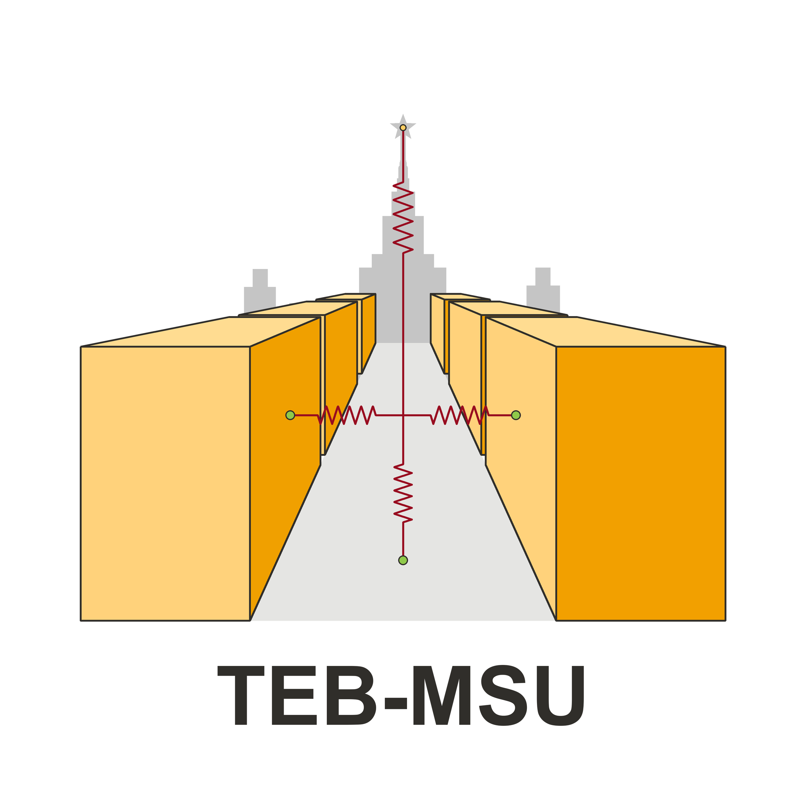
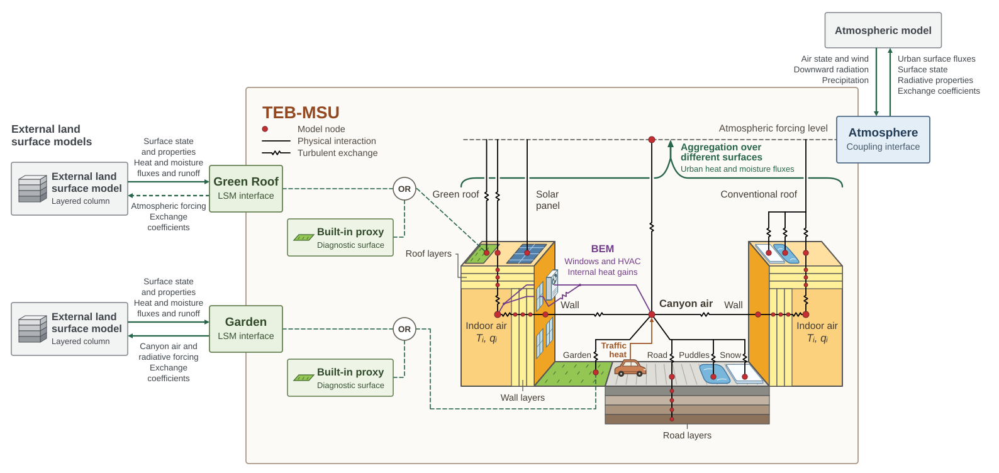

# TEB-MSU: Single-Layer Urban Canopy Model

[](https://fortran-lang.org/)
[](https://www.python.org/)
[](https://cecill.info/licences/Licence_CeCILL-C_V1-en.html)

<p align="left">
  
</p>


TEB-MSU is a single-layer urban canopy model developed at Lomonosov Moscow State University based on the popular French open-source model TEB (Town Energy Balance) [[Masson, 2000]](#references). This model provides simplified but computationally effective parameterization of turbulent and radiant energy exchange within the urban canopy described as an idealized street canyon, considering building energy use, including heating and air conditioning, simulated by building energy model (BEM) [[Bueno et al., 2012]](#references). It also allows representing urban vegetation inside the street canyon [[Lemonsu et al., 2012]](#references) and on buildings' roofs [[De Munck et al., 2013]](#references), as well as solar panels on the roofs.



## Key Features

- **Single-layer urban canopy scheme** with idealized street canyon geometry
- **Building Energy Model (BEM)** for simulating heating and air conditioning energy use
- **Urban vegetation** inside street canyons and on green roofs
- **Solar panels** on building roofs
- **Advanced wind profile** parameterization following [[Wang, 2012]](#references) verified with microscale modelling [[Tarasova et al., 2024]](#references)
- **Anthropogenic heat flux** from traffic with diurnal cycle parameterization
- **Flexible coupling interface** for standalone mode with given atmospheric forcing or two-way coupling with atmospheric models (e.g., COSMO) [[Tarasova et al., 2025]](#references)

## Distinctive Features of TEB-MSU

Compared to the original TEB model, TEB-MSU includes:

- **Improvements to physical parameterizations** and their adaptation to Russian cities
- **Elaborate program interfaces** for easier coupling and configuration
- **Multiple modifications to BEM** for better representation of urban energy consumption
- **New wind speed profile parameterization** following the Wang (2012) approach
- **New parameterization of diurnal cycle** of anthropogenic heat flux from traffic
- **New interface for coupling with land surface models** for describing soil and vegetation in street canyons
- **Flexible mode switching** between standalone and coupled operation
- **Python library suite** for preparing atmospheric forcing data, including utilities for processing meteorological observations, reanalysis data, and generating input files for offline simulations

The development line (`src_dev`, see [Two source trees](#two-source-trees-src_dev-and-src_ctrl)) additionally contains:

- **Fixes of defects of the original TEB** found during this work: the weighting of the snow fluxes in the canyon nodes, the latent heat of the phase change (`XLVTT`/`XLSTT`), the melt-water path, and the uninitialised radiation diagnostics of the green surfaces and canyon ground temperature — [`docs/TEB_MSU_source_defects.md`](docs/TEB_MSU_source_defects.md)
- **canyon bypass (CBS) scheme of the surface–canyon exchange**: a weight τ ∈ [0, 1] blends the "through the canyon" and the "directly to the forcing level" paths (τ = 1 reproduces the original TEB, τ → 0 makes the surface flat); the air seen by the surfaces is a τ-relaxation of the classical canyon node (`T_CAN0`) and of the surface layer (`T_CAN1`) — [`docs/TEB_MSU_CBS_scheme_T_CAN_reformulation.md`](docs/TEB_MSU_CBS_scheme_T_CAN_reformulation.md)
- **Diagnostic garden and green-roof scheme**: the surface energy balance `Rn = H + LE` with a surface relative humidity, solved by Newton iterations, coupled to the canyon air, with external modes (`EXT`, `EXT_NEU`) — [`docs/TEB_MSU_garden_diagnostic_scheme.md`](docs/TEB_MSU_garden_diagnostic_scheme.md)
- **Pedestrian mean radiant temperature and thermal comfort.** TEB-MSU reports MRT from the width-mean absorbed radiation at 1.1 m, conditional MRT in sun and shade, the sunlit fraction at body height and MRT on an open roof. Canyon UTCI combines each of the three street MRTs with canyon air temperature, humidity and pedestrian wind. [MRT and UTCI scheme](docs/TEB_MSU_MRT_pedestrian_scheme.md)
- **Urban roughness and displacement height from the namelist or from the Macdonald et al. (1998) morphometric scheme** [[Macdonald et al., 1998]](#references) instead of the hard-coded `zd = H/3` correction — [`docs/TEB_MSU_source_defects.md`](docs/TEB_MSU_source_defects.md) (D7)

### Quick Start

#### Option 1: Google Colab (Recommended)

Open and run the [`TEB_sandbox.ipynb`](https://github.com/mkolennikova/TEB-MSU/blob/main/TEB_sandbox.ipynb) notebook in Google Colab. It will automatically:

1. Clone the repository
2. Set up the environment
3. Compile the model (the source tree `src_dev` or `src_ctrl` is selected in the notebook)
4. Download the ERA5 meteorological forcing for the chosen site and period
5. Run a test simulation
6. Visualize the results

The same notebook is also the local (Windows) pipeline: it detects the repository, the
toolchain and the Python environment instead of installing anything.

#### Option 2: Local Build

The development build requires GNU Make 4.0 or newer, a Fortran compiler,
an archiver and a POSIX shell. Select `FC` and `LD` explicitly. GNU Fortran is
the dev default; the existing Intel `ifort` flag profile is also retained.
All generated files must be outside the checkout (see [AGENTS.md](AGENTS.md)).
Use absolute paths without spaces and a separate build root for each compiler
and flag set.

For Linux or another POSIX environment, select an external work root:

```sh
export TEB_WORK_ROOT="$HOME/Work_TEB"
build_root="$TEB_WORK_ROOT/TEB-Ru/manual/build/gfortran-dev"
make -C src_dev library FC=gfortran LD=gfortran BUILD_ROOT="$build_root"
make -C src_dev offline FC=gfortran LD=gfortran BUILD_ROOT="$build_root"
```

On this Windows workstation, use the matching MSYS2 UCRT64 tools and shell:

```powershell
$env:PATH = 'C:\msys64\ucrt64\bin;C:\msys64\usr\bin;' + $env:PATH
$buildRoot = 'W:/Work_TEB/TEB-Ru/manual/build/gfortran-dev'
make -C src_dev library FC=gfortran LD=gfortran BUILD_ROOT=$buildRoot SHELL=C:/msys64/usr/bin/sh.exe
make -C src_dev offline FC=gfortran LD=gfortran BUILD_ROOT=$buildRoot SHELL=C:/msys64/usr/bin/sh.exe
```

The `library` target creates `lib/libteb.a` and `common/mod/*.mod` below
`BUILD_ROOT`; `offline` links `bin/TEB_offline_dev.exe` with that archive.
The default target `all` is an alias for `offline`. Common, offline and
platform objects have separate directories. `make ... print-config` reports
the exact paths and platform linker flags; `platform` builds the optional
Windows/GNU support object for another consumer.

The source lists are explicit in [teb_sources.mk](src_dev/make/teb_sources.mk),
including four common `.cdk` include files; module dependencies are in
[teb_dependencies.mk](src_dev/make/teb_dependencies.mk). The library can be
built without `src_offline/`. Experimental source snapshots and the unused
`mode_char2real`/`modd_arch` pair are excluded from the archive.
Fortran module files are compiler-specific: a consumer must use a compatible
compiler, numerical kind and ABI. Compile against `common/mod`, then link
consumer objects followed by `libteb.a`. The Windows/GNU runtime workaround
is applied during final linking and is not stored in the physics archive.

The public `sfc_teb` module exports `teb_interface`, `teb_finalize`,
`teb_real_kind` and `teb_undef` (the library's undefined-value sentinel).
The optional `teb_interface` argument, `teb_snow_check`, selects the
shared snow filter for that call; omitting it preserves the current setting.
The offline driver passes the namelist setting at every step. Call
`teb_finalize()` at host shutdown to close diagnostic files and release the
workspace. It is safe before initialization and on repeated calls, and leaves
host-owned state and physical settings intact. A subsequent warm call must
provide the saved state and a nonzero `ntstep`.

A build profile records compilation and linking settings and rejects reuse
with different settings. Choose a new `BUILD_ROOT`, or explicitly clean that
profile. `clean` removes only named artifacts of that profile; it does not
delete directories recursively. The legacy `convert_makefile.sh` refuses
to overwrite this split build.

Run from an external case directory. For example, starting at the repository
root in a POSIX shell and using a fresh task directory:

```sh
case_root="$TEB_WORK_ROOT/TEB-Ru/manual/runs/CAPITOUL"
mkdir -p "$case_root/output"
cp -R tests/CAPITOUL/input tests/CAPITOUL/namelist "$case_root/"
cd "$case_root"
"$build_root/bin/TEB_offline_dev.exe" -param_nml "$case_root/namelist/namelist.nml" -forcing_nml "$case_root/namelist/namelist_forcing.nml" -output "$case_root/output"
```

The notebook build cell uses an external profile too. Saved notebook output
may show older paths; new executions use the explicit executable location.

### Shared scalar/block offline driver (`src_dev`)

Both `TEB_offline_dev.exe` and `TEB_offline_block_dev.exe` call the same
offline driver. `nvec=1` selects an ordinary column; larger values select a
block. `offline-block` builds the additional thin main program, linked with the
same offline objects and `libteb.a`. The physics library remains independent of
the offline configuration, forcing and output modules.

Both entry points accept the same command, run from an external case directory:

```powershell
W:/Work_TEB/TEB-Ru/my-build/bin/TEB_offline_dev.exe -param_nml parameters.nml -forcing_nml forcing.nml -output .
```

The parameter file contains `&tebopts` (runtime `nvec`, timestep `dt`, common scheme settings
and output switches) and `&tebparams` (physical parameters and initial values).
In `src_dev`, the CBS switch, H/W threshold and transition width belong in `&tebopts`.
For a cell-dependent parameter, supply one literal for the whole block or
exactly `nvec` literals. Repetition notation, null elements, partial indexed
assignments and duplicate keys are rejected. Omitted parameters retain their
defaults. A supplied `teb_fai` profile has eight directional values shared by
every cell and block. When omitted, `src_dev` derives an isotropic FAI for each
cell from its wall area index. The forcing file retains the common
`&tebforcing` series.

```fortran
&tebopts
 nvec=3,
 dt=300.,
 teb_ctype_wind='WANG',
 teb_ctype_bem='BEM',
 teb_lcbs_scheme=.TRUE.,
/
&tebparams
 urb_h_bld=12.,20.,28.,
 urb_h2w=1.5,
 ahf_traffic=0.,20.,40.,
 teb_fai=.5,.5,.5,.5,.5,.5,.5,.5,
/
```

The split format uses `teb_ctype_*` selector keys; `teb_ctype_wind` is `'DEF'`
or `'WANG'`. The API retains its original selector names and numeric wind codes.
The old monolithic `&tebparam` retains its former keys and numeric wind selector
and remains readable for scalar runs; mixing old and
new groups is an error. `src_ctrl` also accepts `tebopts/tebparams` for
`nvec=1` and retains legacy `tebparam` support. Its physical defaults and
numerical operations are preserved; unsupported enabled options are rejected.

Each active cell produces `TEB_output_b<B>_c<C>.csv`,
`TEB_emu_b<B>_c<C>.csv` and `TEB_runoff_b<B>_c<C>.csv`. Single-column, single-block
runs retain `TEB_emu.csv` and `TEB_runoff.csv`. Main and emulator diagnostics
retain their existing sample timing; runoff is averaged over the forcing
interval independently for each cell. `cells.csv` and `parameters.csv` identify
the columns and their expanded configuration. Detailed controls and output
semantics are in [the variables description](docs/TEB_MSU_variables_description.md).

The optional `-config <block_test.nml>` adds diagnostic controls: synthetic
forcing, perturbations, masks, permutations and checkpoint/restart. Physics is
always read from the same `-param_nml` file (or `param_nml` in `block_test`).
Profile labels select test recipes in Python; Fortran does not maintain a
second set of profile parameters. The binary test dump is enabled with
`teb_lwrite_test_dump=.TRUE.` in `tebopts`.

Run the existing suite with a fresh external path:

```powershell
python -B python_tests/check_offline_block.py --out-root W:/Work_TEB/TEB-Ru/block-check-001
```

The suite checks `nvec=1,2,7,16,31`, explicit parameter lists, common forcing,
independent reference processes, masks, permutations, all three CSV streams and
restart inside a runoff interval. Instrumented external API copies check both
inter-step memory loads and their deliberate removal. `--quick` reduces the
main size matrix; `--exe` uses an existing matching build, and
`--skip-memory-probe` omits instrumentation. All generated files stay below
`--out-root`; an FPE or process failure fails the suite.

### Comparing the control and development trees

`python_tests/ctrl_dev_base_test/compare.py` generates one shared
`tebopts/tebparams` file per case, with `nvec=1` and CBS explicitly disabled.
It builds dev with `TEB_UPSTREAM_CONS_BUGS` and ordinary ctrl, preserving the
existing numerical comparison and activity criteria. Inputs, separate build
profiles and runs stay outside the checkout. See the
[comparison test instructions](python_tests/ctrl_dev_base_test/README.md).

### Two source trees: `src_dev` and `src_ctrl`

The Fortran sources are split into two independent trees, each with its own `Makefile` and
`gfortran_args` and its own executable:

| Tree | Physics | Builds |
| --- | --- | --- |
| `src_dev/` | development line (branch `MV_devs`) with the modern I/O | `<BUILD_ROOT>/lib/libteb.a` and `<BUILD_ROOT>/bin/TEB_offline_dev.exe` |
| `src_ctrl/` | control line based on the first commit `582c3ab`, with common D7–D9 fixes and scalar split/legacy namelist support | executable selected with absolute external `OBJDIR` and `EXEC` |

Both trees share `tests/`, `python/` and `docs/`. Dev builds the offline host
through its common library; ctrl retains its existing Makefile and numerical
flags. Both write the same columns to the per-cell tables
`TEB_output_b<block>_c<cell>.csv`, so runs of the two trees can be compared line by line.

For a controlled comparison of inherited defects D1–D5 and D10, build `src_dev`
with `CPPDEFS=-DTEB_UPSTREAM_CONS_BUGS`. The normal build keeps the corrected
formulas. The control tree uses a consistent displacement height by default;
its existing `TEB_UPSTREAM_CONS` switch also restores the original D7 wind and
aerodynamic formulas for comparison with official TEB. Keep a separate object
directory and executable for each set of preprocessor flags, for example:

```sh
make -C src_dev FC=gfortran LD=gfortran BUILD_ROOT="$TEB_WORK_ROOT/TEB-Ru/manual/build/dev-bugs" CPPDEFS=-DTEB_UPSTREAM_CONS_BUGS
make -C src_ctrl OBJDIR="$TEB_WORK_ROOT/TEB-Ru/manual/build/ctrl-upstream/obj" EXEC="$TEB_WORK_ROOT/TEB-Ru/manual/build/ctrl-upstream/TEB_offline_ctrl.exe" CPPDEFS=-DTEB_UPSTREAM_CONS
```

On Windows, pass `FC=gfortran LD=gfortran` explicitly and use the matching POSIX shell. The scopes of both switches are listed in
[`docs/TEB_MSU_source_defects.md`](docs/TEB_MSU_source_defects.md).

The [ctrl/dev comparison bench](python_tests/ctrl_dev_base_test/README.md)
checks the shared CAPITOUL physics across several configurations, including
the historical garden and greenroof proxies; CBS remains disabled.

## Repository Layout

| Path | Content |
| --- | --- |
| [`AGENTS.md`](AGENTS.md) | Shared instructions for coding agents: source-tree roles, approval for control-physics changes, and external build/test workspaces |
| `src_dev/` | Development sources: public `src_api/`, shared `src_driver/` and physics directories, offline-only `src_offline/`; explicit library/offline manifests in `make/`, external build products |
| `src_ctrl/` | Control Fortran sources (same layout, physics of the first commit); builds `build/TEB_offline_ctrl.exe` |
| `python/` | Python libraries shared by the notebook and the test benches: output handling (`output_utils.py`), forcing preparation (`forcing_ERA5.py`, `forcing_utils.py`) and the notebook helpers (`run_utils.py`, `install_utils.py`) |
| `python_tests/` | Python test benches and comparison/sensitivity experiments verifying the model revisions |
| `tests/` | Test cases; `tests/CAPITOUL/` is the reference case: `namelist/`, `input/` (ASCII forcing) and `output_ref/` |
| `build/` | Build output of `make`: `obj_dev/`, `obj_ctrl/`, `logs/` (the `make` logs) and the executables; created automatically and not tracked |
| `docs/` | Model documentation includes the variable description (`TEB_MSU_variables_description.md`), the [dynamic town aerodynamics scheme](docs/TEB_MSU_dynamic_town_aerodynamics.md), the canyon bypass scheme (`TEB_MSU_CBS_scheme_T_CAN_reformulation.md`), the diagnostic garden and green-roof scheme (`TEB_MSU_garden_diagnostic_scheme.md`), the pedestrian mean radiant temperature on the road (`TEB_MSU_MRT_pedestrian_scheme.md`), the defects of the original TEB found and fixed in TEB-MSU (`TEB_MSU_source_defects.md`), the diagnostics container (`TEB_MSU_containers.md`), the commit-referenced change history (`TEB_MSU_change_history.md`), the [trace snowfall filter](docs/TEB_MSU_snow_check.md) and the documentation rules (`TEB_MSU_documentation_rules.md`) |
| `schemes/` | Model diagrams in `img/` and drawing scripts in `draw/` |
| `img/` | Images used by `README.md` and `TEB_sandbox.ipynb`: the project logo `TEB-MSU_logo_v3.png` (the editable design sources are kept outside the repository, see `/logo_design/` in `.gitignore`) |
| `TEB_sandbox.ipynb` | Step-by-step pipeline notebook: Google Colab and local (Windows) build and run |

The coupling is documented in `docs/TEB_MSU_COSMO_coupling.md` on the working branch
`codex/teb-ru-coupling` of the [COSMO-TEB repository](https://github.com/mkolennikova/COSMO-TEB).

The executable is started in the directory of the case, because the driver reads `namelist/` and
the forcing directory and writes `output/` relative to the working directory (for the reference
case that is `tests/CAPITOUL/`). The command-line options `-forcing_nml`, `-param_nml` and
`-output` override each of them; `-verbose` additionally asks the model to echo its
configuration once per run (see below).

## Configuration

The model is configured by two Fortran namelist files — `namelist.nml` (model parameters) and
`namelist_forcing.nml` (atmospheric forcing and the period of the run) — which the driver reads at
start-up. They must be composed according to the rules of
[`docs/TEB_MSU_variables_description.md`](docs/TEB_MSU_variables_description.md), which documents
every item, its type, units, accepted values and defaults.

Namelist examples for CAPITOUL test case availible at  
[`tests/CAPITOUL/namelist/`](https://github.com/mkolennikova/TEB-MSU/tree/main/tests/CAPITOUL/namelist).

- **[namelist_forcing.nml](https://github.com/mkolennikova/TEB-MSU/blob/main/tests/CAPITOUL/namelist/namelist_forcing.nml)** – example of the atmospheric forcing parameters (temperature, humidity, wind, radiation, precipitation, etc.) and of the run period
- **[namelist.nml](https://github.com/mkolennikova/TEB-MSU/blob/main/tests/CAPITOUL/namelist/namelist.nml)** – example of the urban geometry, material properties, BEM parameters, vegetation settings and other model options

For another site, copy and adapt these examples (the notebook `TEB_sandbox.ipynb` writes its own
`params_<experiment>.nml` from the CAPITOUL parameters).

<!-- MV202609 strict namelist date/time reading -->
⚠️ **The driver stops if a namelist cannot be read.** Both namelist files
(`namelist_forcing.nml` and `namelist.nml`) are read with the same policy: on an
`IOSTAT > 0` the run stops with an error (**no parameters are silently taken from the
program**), the log lists every declared item of the failing group with its line
number and its state, and the **first line at which the read fails** is reported. The
items that are simply not present in the file are listed separately, together with the
notice that the driver default is used for them.

Integer items must be written without a decimal point: `teb_year`, `teb_month`,
`teb_day`, `teb_hour`, `teb_min`, `nsteps` and `teb_utc_hour` are INTEGER items and a
real value (`teb_hour = 0.0`) makes the READ fail at that entry. The start date/time
items of the forcing namelist have **no default value** any more and are validated
(range check): a run without a valid start date cannot start. The start date, the end
date of the run, the forcing window and the location are echoed in the log.

### Model Output

Each owner writes its own files into `<output_dir>` (`-output <dir>` on the command
line, `output/` by default):

| file | written by | content |
| --- | --- | --- |
| `TEB_output_b<block>_c<cell>.csv` | TEB (`TEB_LOG`) | the universal table of the cell: time, model variables and the atmospheric forcing used at that step (`Forc_*`), one line per forcing step |
| `TEB_emu.csv` | driver | the columns of the external garden/green-roof emulator (`EMU_*`), only for the `EXT`/`EXT_NEU` configurations |
| `TEB_runoff.csv` | driver | the road and roof runoff accumulated over the sub-steps of each forcing step |

All three are semicolon-separated with a header line. The first column of the universal
table is `time` (ISO 8601, the end of the forcing interval, e.g. `2004-02-20 00:30:00`);
the list of its columns depends on the model options (e.g. `HVAC_*` only with the
Building Energy Model, `SOLAR_PROD` only with solar panels) and is printed once per run
as the `Output columns:` line of the console.

The console belongs to the driver: banner, namelist diagnostics, progress and the final
line. The model itself prints only errors and the `Output columns:` line; `-verbose`
adds its configuration dump, printed once per run.

The Python utility [`python/output_utils.py`](python/output_utils.py) reads this file (the
`Forc_*` columns it contains are used as the forcing overlay in the plots) as well as the
legacy per-variable `*.txt` output of older runs:

```python
import output_utils

df = output_utils.read_output('output/TEB_output_b1_c1.csv')  # the output file itself
df = output_utils.read_output('output/')                      # ... or its directory
df = output_utils.read_output('output_old/', fmt='txt',   # legacy <VAR>.txt files
                              namelist_path='namelist_forcing.nml')
```

### Compiler Flags

Compiler settings are defined in [`src_dev/gfortran_args`](https://github.com/mkolennikova/TEB-MSU/blob/main/src_dev/gfortran_args)
(the same file exists in [`src_ctrl/gfortran_args`](https://github.com/mkolennikova/TEB-MSU/blob/main/src_ctrl/gfortran_args)).
Select `FC` and `LD` explicitly. Dev defaults to GNU Fortran; ctrl keeps
its existing compiler detection. Dev retains GNU and Intel `ifort` flag profiles.

Key compilation flags:
- `-ffree-line-length-0` – Allow unlimited line length (avoids line truncation errors)
- `-fdefault-real-8` – Use double precision real numbers
- GNU `-J$(MODDIR)` / `-J$(OFFLINE_MODDIR)` – Keep dev module files separate from objects and from each other

On Windows the build additionally links `libgfortran` statically and applies a small
workaround for a locale defect of the UCRT runtime (`src_dev/src_driver/wrap_setlocale.c`,
also in `src_ctrl`): the formatted output of real numbers of `libgfortran` saves a
`setlocale` pointer that the UCRT invalidates, which causes rare `SIGSEGV` failures of long
runs. The workaround does not change the results (`WRAP_LOCALE=0` disables it explicitly);
details and measurements are in §5.8 of
[`docs/TEB_MSU_change_history.md`](docs/TEB_MSU_change_history.md).

## References

1. [Bueno, B., Pigeon, G., Norford, L.K., Zibouche, K., Marchadier, C., 2012. Development and evaluation of a building energy model integrated in the TEB scheme. Geoscientific Model Development 5, 433–448.](https://doi.org/10.5194/gmd-5-433-2012)

2. [De Munck, C.S., Lemonsu, A., Bouzouidja, R., Masson, V., Claverie, R., 2013. The GREENROOF module (v7.3) for modelling green roof hydrological and energetic performances within TEB. Geoscientific Model Development 6, 1941–1960.](https://doi.org/10.5194/gmd-6-1941-2013)

3. [Lemonsu, A., Masson, V., Shashua-Bar, L., Erell, E., Pearlmutter, D., 2012. Inclusion of vegetation in the Town Energy Balance model for modelling urban green areas. Geoscientific Model Development 5, 1377–1393.](https://doi.org/10.5194/gmd-5-1377-2012)

4. [Macdonald, R.W., Griffiths, R.F., Hall, D.J., 1998. An improved method for the estimation of surface roughness of obstacle arrays. Atmospheric Environment 32, 1857–1864.](https://doi.org/10.1016/S1352-2310(97)00403-2)

5. [Masson, V., 2000. A Physically-Based Scheme For The Urban Energy Budget In Atmospheric Models. Boundary-Layer Meteorology 94, 357–397.](https://doi.org/10.1023/A:1002463829265)

6. [Meyer, D., Schoetter, R., Masson, V., Grimmond, S., 2020. Enhanced software and platform for the Town Energy Balance (TEB) model. Journal of Open Source Software 5, 2008.](https://doi.org/10.21105/joss.02008)

7. [Tarasova, M.A., Debolskiy, A.V., Mortikov, E.V., Varentsov, M.I., Glazunov, A.V., Stepanenko, V.M., 2024. On the Parameterization of the Mean Wind Profile for Urban Canopy Models. Lobachevskii Journal of Mathematics 45, 3198–3210.](https://doi.org/10.1134/S1995080224603801)

8. [Tarasova, M.A., Varentsov, M.I., Debolskiy, A.V., Stepanenko, V.M., 2025. Coupling the Town Energy Balance (TEB) Scheme with the COSMO Atmospheric Model: Evaluation Against a Bulk Parameterization (TERRA_URB) for the Moscow Megacity. GES 18, 118–134.](https://doi.org/10.24057/2071-9388-2025-3975)

9. [Wang, W., 2012. An Analytical Model for Mean Wind Profiles in Sparse Canopies. Boundary-Layer Meteorology 142, 383–399.](https://doi.org/10.1007/s10546-011-9687-0)

## Citation

If you use TEB-MSU in your research, please cite:

> [Tarasova, M.A., Varentsov, M.I., Debolskiy, A.V., Stepanenko, V.M., 2025. Coupling the Town Energy Balance (TEB) Scheme with the COSMO Atmospheric Model: Evaluation Against a Bulk Parameterization (TERRA_URB) for the Moscow Megacity. GES 18, 118–134.](https://doi.org/10.24057/2071-9388-2025-3975)

Also, please cite the original TEB model and the relevant references listed above.

## License

TEB-MSU is distributed under the [CeCILL-C](https://cecill.info/licences/Licence_CeCILL-C_V1-en.html) license, following the original TEB model.

## Acknowledgments

TEB-MSU development is supported by Lomonosov Moscow State University and acknowledges the original TEB model development team at CNRM (Météo-France/CNRS).
