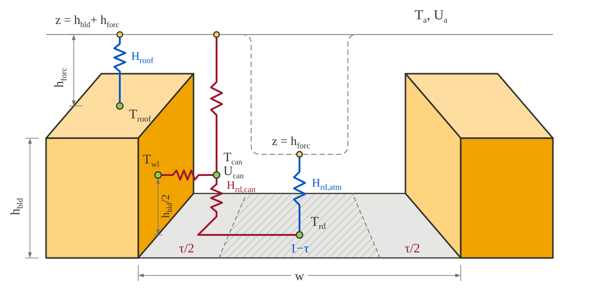

# CBS (canyon bypass scheme) for road and garden fluxes in TEB-MSU: formulation, mathematics and implementation

This document describes the **implemented** TEB-MSU CBS scheme: its purpose,
physical meaning, budget equations, properties, numerical details and diagnostics.
It describes the current state of the scheme.

Related documents:

* `TEB_MSU_garden_diagnostic_scheme.md` — diagnostic garden proxy model
  (including its garden↔canyon / garden↔atmosphere τ branches);
* `../TEB_MSU_source_defects.md` — defects of the original TEB found and fixed
  during development;
* `../TEB_MSU_containers.md` — the `DIAG_MISC_TEB_t` diagnostics container,
  which stores the road and canyon branch diagnostics;
* `../TEB_MSU_change_history.md` — concise change history with a link to the
  archive of detailed descriptions and measurement protocols.

> Code state: `main`, based on `2924997` with the road ZQ0 term ported.

**Abstract.** Classical TEB exchanges heat and moisture between the road and canyon
air, and between the canyon and air at the forcing level. For sparse buildings
(H/W → 0), there is effectively no canyon, and this two-layer construction adds
an unnecessary thermal layer above the surface. CBS introduces a weight τ ∈ [0, 1]
for the fraction of exchange passing through the canyon; the remainder `(1−τ)`
represents direct exchange between the surface and air at the forcing level.
As τ → 0, the road behaves as a flat surface; at τ = 1, the original TEB is
reproduced. The air temperature experienced by canyon surfaces is a τ blend of
two endpoints: the classical canyon node `T_CAN0` and the free-layer temperature
`T_CAN1`, obtained from Monin–Obukhov similarity theory at height H/2.



**Figure 1.** Sensible heat exchange in the CBS transition regime (`0 < τ < 1`).
Burgundy connections show road and wall exchange with canyon air and canyon
ventilation; blue connections show direct road and roof exchange with the
atmosphere. The hatched central strip represents the fraction `1−τ`; the two
side strips, each `τ/2`, represent the total fraction `τ`. This is a conceptual
separation of exchange paths: there is a single road temperature `T_rd`.
The symbols `H_rd,can` and `H_rd,atm` denote potential branch fluxes; the actual
flux is their weighted sum (§4.2). Heights use lowercase `h`, canyon width
uses `w`, and sensible heat flux uses uppercase `H`. The solid and lower dashed
lines show the levels `z = h_bld + h_forc` and `z = h_forc` used to calculate
exchange along the respective paths; the wall and canyon-air nodes are at
`h_bld/2`. The variables `T` and `U` denote temperature and wind speed.

The [figure source script](../../illustrations/draw/draw_cbs.py) generates the SVG
with `python illustrations/draw/draw_cbs.py`, run from the repository root.

---

## 1. Purpose, configuration and code location

**Purpose.** CBS describes the transition from a dense canyon to an isolated
building:

* at τ = 1, the surface exchanges with canyon air (classical TEB);
* at τ = 0, it exchanges directly with air at the forcing level, as a flat surface;
* at intermediate τ, exchange is split into two branches with weights τ and 1−τ.

The scheme applies to the **road** (road budget, canyon temperature and humidity
nodes), **road snow** (snow↔atmosphere branch) and **garden** (garden↔canyon /
garden↔atmosphere branches; see the garden document). Walls and windows, roofs,
traffic and waste heat are not split by the scheme (see §6).

**`src_dev` configuration**

| Namelist group | Key | Meaning | Default |
| --- | --- | --- | --- |
| `&tebopts` | `teb_lcbs_scheme` | Enable CBS | `.FALSE.` |
| `&tebopts` | `teb_cbs_hw_thresh` | H/W at which τ = 0.5 | `0.5` |
| `&tebopts` | `teb_cbs_hw_width` | Width of the tanh transition | `0.25` |

The threshold and width are scalars for the entire block.

The flag, threshold and width are stored in `TOPTS%LCBS_SCHEME`,
`TOPTS%XTAU_HW_THRESH` and `TOPTS%XTAU_HW_WIDTH`
(`src_dev/src_struct/modd_teb_optionn.F90`). The weight `τ` is computed once
per step by `CBS_TAU` in `TEB_GARDEN` (`src_dev/src_teb/teb_garden.F90`).

```fortran
IF (TOPTS%LCBS_SCHEME) THEN
  ZTAU(:) = CBS_TAU(TPARAMS%XCAN_HW_RATIO(:), TOPTS%XTAU_HW_THRESH, &
                    TOPTS%XTAU_HW_WIDTH, TPARAMS%XBLD_HEIGHT(:))
ELSE
  ZTAU(:) = 1.
ENDIF
```

When the scheme is off, τ = 1 **exactly** (multiplication by `1.` and a zero
term), so the original model is reproduced bit for bit (see §8).

**Where τ is passed.** `ZTAU` is passed as `PTAU` to `TEB` (road budget and
diagnostics), `AVG_URBAN_FLUXES` (canyon temperature and humidity budgets) and
`GARDEN_CBS` (garden branches). The complete list of locations is:

| Location | Quantity weighted by τ |
| --- | --- |
| `src/src_teb/teb.F90` (road-budget section) | Effective road conductance and reference air for `ROAD_LAYER_E_BUDGET` |
| `src/src_teb/avg_urban_fluxes.F90` (canyon temperature node) | Road and road-snow weights in `T_CAN0` |
| `src/src_teb/avg_urban_fluxes.F90` (canyon humidity node) | Road and snow weights in `PQ_CAN0` |
| `src/src_teb/teb_garden.F90` → `src/src_proxi_SVAT/garden.F90` (`GARDEN_CBS`) | Garden canyon and atmospheric conductances, exchange coefficients and reference air |
| Garden-splitting activation | `LCBS_SPLIT = TOP%LCBS_SCHEME .AND. TOP%CTYPE_GARDEN == 'PROXY_NEW'` |

Momentum flux is excluded: τ is not applied to it (§4.8).

The driver's external interfaces (`namelist`, `sfc_teb.F90`,
`call_driver.F90`) are unchanged: τ is computed inside `TEB_GARDEN_STRUCT`
and passed onward through the existing arguments.

---

## 2. Notation

| Symbol | Meaning | Units |
| --- | --- | --- |
| `A_rd` | Road↔canyon-air conductance (`PAC_RD`) | m/s |
| `A_atm` | Road↔forcing-level conductance (`PAC_ROAD_ATM`); includes the `ln(z_ref/z0h)` profile and stability functions | m/s |
| `A_top` | Canyon↔forcing-level conductance (`PAC_TOP`) | m/s |
| `A_wl` | Area-weighted wall and window↔canyon conductance (`PAC_WL·PWL_O_GRND`) | m/s |
| `A_gd` | Corresponding garden conductance (`PAC_GD·ZGD`) | m/s |
| `A_eff(τ)` | Effective road conductance in the road budget | m/s |
| `Ca_h_C`, `Ca_h_A` | Scalar (heat and moisture, using `z0h`) garden conductances for the canyon and atmospheric branches (see the garden document) | m/s |
| `T_rd`, `T_c`, `T_a` | Road surface, canyon-air and forcing-level air temperatures | K |
| `T_CAN0`, `T_CAN1`, `T_CAN` | Air temperatures: classical canyon node, free layer (H/2), τ blend (§4.3) | K |
| `Q` | Anthropogenic flux into the canyon volume (traffic + waste heat) | W/m² (ground) |
| `θ*`, `u*` | Temperature and friction-velocity scales | K, m/s |
| `κ = 0.4` | von Kármán constant (`XKARMAN`) | – |
| `PDF_RD`, `PDN_RD` | Snow-free and snow-covered road fractions | – |
| `ZRD`, `ZGD` | Road and garden area fractions in the ground part of the tile | – |

All budgets are expressed in temperature terms: a flux `H` is converted to
`H/(ρ·cp)`, exactly as it enters the canyon node in the code
(`PH_TRAFFIC/(1−XBLD)/PRHOA/XCPD`).

---

## 3. The weight τ and its properties

```fortran
ELEMENTAL FUNCTION CBS_TAU(HW_RATIO, HW_THRESH, HW_WIDTH, H_BLD) RESULT(TAU)
   REAL, INTENT(IN) :: HW_RATIO, HW_THRESH, HW_WIDTH, H_BLD   ! H_BLD — reserved for future
   TAU = 0.5 * (1.0 + TANH((HW_RATIO - HW_THRESH) / MAX(HW_WIDTH, TINY(1.0))))
END FUNCTION CBS_TAU
```

That is,

```
τ(H/W) = 0.5·[1 + tanh((H/W − thresh)/width)]
```

Properties:

* `τ → 0` as `H/W → 0` (isolated building — flat surface), and `τ → 1`
  as `H/W ≫ thresh` (dense canyon); at `H/W = thresh`, exactly `τ = 0.5`;
* `width` controls the transition width: as `width → 0`, the result becomes a
  step (`tanh` of the argument's sign); zero width is protected by
  `MAX(width, TINY(1.0))`;
* parameters are normalized to morphology rather than urban class: setting
  `thresh = urb_h2w` gives `τ = 0.5` for any morphology (used in experiments
  requiring the worst case of τ averaging);
* τ is a **global** step weight: it is surface-independent and shared by the
  road, snow and garden branches;
* **anthropogenic fluxes are τ-invariant**: `AHF_TRAFFIC`,
  `H_WASTE`/`LE_WASTE` enter canyon and town budgets with full weight for any
  τ (their splitting is performed by the blend itself; see §4.3).

At the default width, a threshold `teb_cbs_hw_thresh ≪ H/W` gives `τ = 1`
(e.g. `−1000`), while `teb_cbs_hw_thresh ≫ H/W` gives `τ = 0`
(e.g. `+100`). These settings are used to check the scheme's limits (§8).

---

## 4. Mathematics

### 4.1 Road budget: effective conductance and reference air

The road's canyon conductance is computed in `URBAN_DRAG` with three
iterations of the convective velocity contribution. On the first pass,
`w*=0`; each later pass uses the previous value in the speed `PU_LOWCAN+w*`.
The source of this contribution in both model trees is:

```text
ZQ0 = (PTS_WALL − PT_CANYON) · PAC_WALL · XWALL_O_GRND
    + (PTS_ROAD − PT_LOWCAN) · PAC_ROAD_CAN · XROAD/(XROAD+XGARDEN)
w* = [(g · PEXNA/PTA) · ZQ0 · XBLD_HEIGHT]^(1/3), if ZQ0 >= 0;
w* = 0, if ZQ0 < 0.
```

In `src_ctrl`, the canyon conductance is named `PAC_ROAD`. The road term is
added only when `XROAD>0`; with no road, the denominator is not evaluated.
Garden temperature does not enter `ZQ0` directly; the garden fraction remains
in the road weight. The garden participates in its own budgets and in canyon-air
state, so its indirect influence remains. `ZQ0` has units K·m/s; it is a local
heating estimate rather than the total `H_TOWN` flux. The third pass produces
the road conductance used by the model; the `w*` computed at its end is not
used subsequently.

`src/src_teb/teb.F90`:

```fortran
ZPAC_RD(:)     = PAC_RD(:)
ZPAC_RD_WAT(:) = PAC_RD_WAT(:)
ZT_REF(:)      = PT_LOWCAN(:)
ZQ_REF(:)      = PQ_LOWCAN(:)
IF (TOP%LCBS_SCHEME) THEN
  ZPAC_RD(:)     = PTAU(:) * PAC_RD(:)     + (1.-PTAU(:)) * PAC_ROAD_ATM(:)
  ZPAC_RD_WAT(:) = PTAU(:) * PAC_RD_WAT(:) + (1.-PTAU(:)) * ZAC_RD_ATM_WAT(:)
  DO JJ = 1, SIZE(PTA)
    IF (ZPAC_RD(JJ) > 0.) THEN
      ZT_REF(JJ) = ( PTAU(JJ) * PAC_RD(JJ) * PT_LOWCAN(JJ)                     &
                     + (1.-PTAU(JJ)) * PAC_ROAD_ATM(JJ) * PTA(JJ) ) / ZPAC_RD(JJ)
    ELSE
      ZT_REF(JJ) = PT_LOWCAN(JJ)
    ENDIF
    IF (ZPAC_RD_WAT(JJ) > 0.) THEN
      ZQ_REF(JJ) = ( PTAU(JJ) * PAC_RD_WAT(JJ) * PQ_LOWCAN(JJ)                 &
                     + (1.-PTAU(JJ)) * ZAC_RD_ATM_WAT(JJ) * PQA(JJ) ) / ZPAC_RD_WAT(JJ)
    ELSE
      ZQ_REF(JJ) = PQ_LOWCAN(JJ)
    ENDIF
  ENDDO
ENDIF
```

In other words:

```
A_eff(τ)   = τ·A_rd     + (1−τ)·A_atm
A_eff_w(τ) = τ·A_rd_w   + (1−τ)·A_atm_w
T_ref(τ)   = [ τ·A_rd·T_c     + (1−τ)·A_atm·T_a     ] / A_eff(τ)
q_ref(τ)   = [ τ·A_rd_w·q_c   + (1−τ)·A_atm_w·q_a   ] / A_eff_w(τ)
```

The assumption of two independent, individually consistent paths connected in
parallel gives a unique algebraically closed construction: the τ mixture of
reference air is exactly what makes the sum of fluxes equal the flux calculated
with mixed conductance and air. Aerodynamic conductance enters the temperature
difference linearly, so the actual road flux is identically the τ combination of
two potential fluxes (§4.2).

The effective conductance and reference air are passed to
`ROAD_LAYER_E_BUDGET`, which solves for surface temperature `T_rd` and the
actual fluxes `DMT%XH_ROAD` (sensible) and `PLEW_RD` (latent). The budget
solver itself is unchanged: it remains a pure energy-balance solver.

Numerical details:

* reference air is needed only where the corresponding effective conductance
  is nonzero: a dry road has zero moisture conductance, and division by it
  would cause `SIGFPE`. Both branches are therefore guarded by `> 0`
  conditions (at zero, the canyon reference is used, which is equivalent for
  a vanishing flux);
* `PTAU` must be assumed-shape (`DIMENSION(:), INTENT(IN)`); otherwise,
  passing array slices to `TEB` is incompatible with an explicit-shape
  declaration.

### 4.2 Actual road flux and branch diagnostics

Since flux is linear in conductance at a fixed surface temperature, the actual
road flux is identically the τ combination of two potential fluxes:

```
H_ROAD  = ρ·cp·[ τ·A_rd·(T_rd − T_c) + (1−τ)·A_atm·(T_rd − T_a) ]
        = τ·H_ROAD_CAN + (1−τ)·H_ROAD_ATM
LE_ROAD = τ·LE_ROAD_CAN + (1−τ)·LE_ROAD_ATM
```

`H_ROAD_CAN/ATM` and `LE_ROAD_CAN/ATM` are diagnostics: the flux that would
occur if the entire road exchanged with canyon air (τ = 1) or directly with
air at the forcing level (τ = 0), at the same surface temperature. The identity
holds to arithmetic precision and propagates through `H_ROAD`/`LE_ROAD`
into `H_TOWN`/`LE_TOWN` and the canyon budgets (§8).

### 4.3 Three canyon temperatures: `T_CAN0`, `T_CAN1`, `T_CAN`

The air temperature experienced by canyon surfaces is a τ blend of two
endpoints (`src/src_teb/avg_urban_fluxes.F90`):

```fortran
T_CAN0 = <canyon-air node without tau>                        ! classical canyon
T_CAN1 = PTA + (theta*/kappa) * PHI_CAN1                       ! free layer, level H/2
T_CAN  = PTAU * T_CAN0 + (1 - PTAU) * T_CAN1                   ! air experienced by surfaces
```

* `T_CAN0` is canyon-air temperature **as if CBS were off**: the road
  exchanges with canyon air (through `PAC_RD` and its own flux), walls and
  windows, the garden and volume sources (traffic, waste heat) heat the same
  volume, and ventilation passes through the canyon top (`PAC_TOP`);
* `T_CAN1` is the air temperature of the layer `[0, H]` when **all** canyon
  surfaces exchange directly with the atmosphere: road, snow and garden
  contribute their surface→atmosphere fluxes, while walls/windows and volume
  sources contribute heat released within the layer;
* `T_CAN` is the τ blend of both values: it is used in surface budgets at the
  next step (`ZT_LOWCAN = ZT_CANYON` in `src/src_driver/call_driver.F90`)
  and output as `T_CANYON`.

Each source enters **both** endpoints, and the blend performs the splitting.
The sensitivity of `T_CAN` to traffic, waste heat or the garden becomes
`τ·(canyon) + (1−τ)·(layer)`, so no separate area partition is needed for
volume sources.

#### `T_CAN0` — canyon node without τ

```fortran
ZINTER = PAC_RD*PDF_RD*ZRD + PAC_GD*ZGD + PAC_WL*PWL_O_GRND + PAC_TOP
T_CAN0 = ( T_ROAD*PAC_RD*PDF_RD*ZRD
         + T_WALL_A*PAC_WL*(1-XGR)*PWL_O_GRND*0.5
         + T_WALL_B*PAC_WL*(1-XGR)*PWL_O_GRND*0.5
         + T_WIN1  *PAC_WL*    XGR *PWL_O_GRND
         + PTA     *PAC_TOP
         + PH_TRAFFIC/(1-XBLD)/(rho*cp)
         + ZRD*PHSN_RD_CAN*PDN_RD/(rho*cp) ) / ZINTER
T_CAN0 = T_CAN0 + ( PTSRAD_GD*PAC_GD*ZGD ) / ZINTER
IF (CBEM == "BEM") T_CAN0 = T_CAN0 + ( XH_WASTE*XF_WASTE_CAN/(1-XBLD)/(rho*cp) ) / ZINTER
```

This solves the steady-state volume budget:

```
ρ·cp·[ A_rd·(T_rd − T_c) + A_wl·(T_wl_eff − T_c) + A_gd·(T_gd − T_c) + A_top·(T_a − T_c) ] + Q = 0

T_c = [ A_rd·T_rd + A_wl·T_wl_eff + A_gd·T_gd + A_top·T_a + Q/(ρ·cp) ]
      / [ A_rd + A_wl + A_gd + A_top ]
```

where `T_wl_eff = (1−XGR)·(T_WALL_A + T_WALL_B)/2 + XGR·T_WIN1`. Since
`1.0·x = x` in binary arithmetic, at τ = 1, `T_CAN = T_CAN0` matches the
previous code **exactly** (the node differs from the classical one only by the
absence of the `PTAU` factors inserted by the initial version of the scheme).

Area factors: `ZRD = XROAD/(XROAD+XGARDEN)`,
`ZGD = XGARDEN/(XROAD+XGARDEN)`,
`PWL_O_GRND = XWALL_O_HOR/(XROAD+XGARDEN)`; with the garden off,
`ZRD = 1`, `ZGD = 0`. All node terms are **per unit ground area**.

With `teb_ctype_z0_town_dyncorr='ZIL2008'`, `PAC_TOP` uses town roughness
corrected for the previous substep's stratification. This conductance enters
`T_CAN0` and the canyon humidity balance (§4.4). Displacement height sets the
origin for above-roof wind speed and town resistance. For `PAC_TOP`, height
is measured from the canyon-air level `PZ_LOWCAN`. Both options are described
in §2.3 of `../TEB_MSU_variables_description.md`.

#### `T_CAN1` — free layer at H/2 (or at the forcing level when H/2 ≥ z_ref)

Layer heat input (per unit canyon area, as in `T_CAN0`):

```fortran
ZH_CAN1 = ZRD*PH_ROAD_ATM                    ! road -> atmosphere (atmospheric branch)
        + ZGD*PH_GD_ATM                      ! garden -> atmosphere (atmospheric branch)
        + rho*cp*PAC_WL*PWL_O_GRND*(T_wallwin_eff - PT_LOWCAN)   ! walls + windows
        + PH_TRAFFIC/(1-XBLD)                ! traffic
        + ZRD*PHSN_RD_ATM*PDN_RD             ! road snow -> atmosphere
        + [ BEM: XH_WASTE*XF_WASTE_CAN/(1-XBLD) ]
```

Layer composition rules (agreed explicitly):

* **road and road snow** enter through their atmospheric branches
  (`PH_ROAD_ATM`, `PHSN_RD_ATM`), i.e. the flux that would occur under
  direct exchange with the forcing level;
* **garden** enters through the atmospheric branch of its diagnostic balance
  (`PH_GD_ATM`) when garden τ splitting is enabled; otherwise, the model
  flux `PH_GD` is used (see the garden document);
* **walls and windows** enter as heat released within the layer: the already
  computed model flux uses the same `PAC_WL` and lagged `PT_LOWCAN` as the
  façade budget, without a new network node (otherwise canyon wind speed,
  and thus morphology, would enter the free path);
* **traffic and waste heat** are volume sources with full weight;
* **roofs** and `XH_INDUSTRY` **are excluded**: roofs are not canyon surfaces
  (their flux already goes directly to the atmosphere and is included in
  `H_TWN`); industrial heat is excluded by design.

Similarity profile (`u*`, `θ*`, `L`, level `H/2`):

```fortran
ZU_ROAD_ATM = MAX( SQRT(MAX(PCD_ROAD_ATM,0.))*PVMOD , 0.01 )     ! u*, m/s
ZTH_CAN1    = ZH_CAN1 / (PRHOA*XCPD*ZU_ROAD_ATM)                 ! theta*, K
ZL_CAN1     = - ZU_ROAD_ATM**2 * PTA / (XKARMAN*XG*ZTH_CAN1)     ! L, m
ZZ_MID      = MAX( 0.5*T%XBLD_HEIGHT, 1. )                       ! level H/2
PHI_CAN1    = 0.                                                 ! if H/2 >= z_ref
IF (ZZ_MID < PZREF) THEN                                         ! otherwise MOST profile
  PHI_CAN1  = LN(PZREF/ZZ_MID)
            - PSI_H_BD(MIN(PZREF/ZL_CAN1 , 1.)) + PSI_H_BD(MIN(ZZ_MID/ZL_CAN1, 1.))
ENDIF
PT_CAN1     = PTA + (ZTH_CAN1/XKARMAN) * PHI_CAN1
```

* `PCD_ROAD_ATM` is the **dimensionless** drag coefficient of the
  road↔atmosphere diagnostic (`SURFACE_CD`: `PCDN = (κ/ln(z/z0))²`,
  `PCD = PCDN·ZFM`), so `u* = √PCD·PVMOD` is the model's own `u*`
  for this path;
* `PVMOD` is the same wind speed used by model conductances;
* `PTA` in `AVG_URBAN_FLUXES` is air **at roof level**
  (`ZTA = PTA·PEXNS/PEXNA` in `src/src_teb/teb_garden.F90`), so
  `T_CAN1`, like `T_CAN0`, is consistent with that air rather than the
  forcing temperature;
* `H/2` is chosen because it is the standard level of canyon variables in
  TEB (`ZZ_LOWCAN = XBLD_HEIGHT/2` in `src/src_driver/call_driver.F90`);
  the level has a 1 m lower bound;
* if `H/2 ≥ z_ref`, the MOST profile anchored at `z_ref` is undefined there
  (the anomaly would be nonpositive), and the free layer is identified with
  air at the forcing level: `PHI_CAN1 = 0`, `T_CAN1 = PTA`
  (and `PQ_CAN1 = PQA`);
* `PSI_H_BD` is a Businger–Dyer heat stability function with the coefficients
  used in `SURFACE_CD`/`SURFACE_AERO_COND`: unstable
  `2·ln[(1+√(1−15ζ))/2]`, stable `−5ζ`; it is an internal function in
  `avg_urban_fluxes.F90`;
* under strong stability, the argument is capped at one
  (`ZETA_STAB_MAX = 1.`): an unbounded `−5ζ` would produce unphysical
  anomalies, whereas the cap bounds the profile from above (when
  `H/2 < z_ref`, `PHI_CAN1` does not exceed `ln(z_ref/(H/2)) + 5`;
  otherwise, `PHI_CAN1 = 0`);
* with `|θ*| < 1e-10` (or invalid inputs) and `H/2 < z_ref`, the neutral
  value `PHI_CAN1 = LN(PZREF/ZZ_MID)` is used. The `ZOK_CAN1` flag rejects
  invalid inputs (nonpositive `PCD_ROAD_ATM`, `ZZ0H_ROAD_ATM`, `PVMOD`),
  particularly cells without roads.

Layer humidity uses the same construction (with the corresponding latent-heat
terms):

```fortran
ZLE_CAN1 = ZRD*PLE_ROAD_ATM + ZGD*PLE_GD_ATM + traffic (+ waste heat with BEM)
ZLE_CAN1_SN = ZRD*PLESN_RD_ATM*PDN_RD*XLVTT/XLSTT      ! snow: sublimation (XLSTT)
PQ_CAN1  = PQA + ( ZLE_CAN1 + ZLE_CAN1_SN ) / ( rho*XLVTT*XKARMAN*ZU_ROAD_ATM ) * PHI_CAN1
PQ_CAN   = PTAU*PQ_CAN0 + (1-PTAU)*PQ_CAN1
```

The snow contribution is converted to an `XLVTT` equivalent before the single
division in the layer formula: snow latent heat uses `XLSTT` (sublimation),
while liquid sources use `XLVTT`. This conversion preserves both each source's
physics and the operation order (with `PDN_RD = 0`, the result is unchanged).

The neutral limit `PSI_H_BD ≡ 0` at `H/2 < z_ref` gives the checkpoint
`PHI_CAN1 = ln(z_ref/(H/2))` (for `z_ref = 10` m and `H = 6` m, this
is `ln(10/3) = 1.204`); at `H/2 ≥ z_ref`, the checkpoint is
`PHI_CAN1 = 0` (and `T_CAN1 = PTA`).

#### Properties of the revision

* `T_CAN = PTAU·T_CAN0 + (1−PTAU)·T_CAN1`; at τ = 1 this is exactly
  `T_CAN0` (multiplication by `1.0` is exact), and at τ = 0 exactly
  `T_CAN1`;
* `T_CAN1` **contains no urban morphology**: it has no `PAC_TOP`,
  `ZZ0_TOP`, canyon speed or canyon length. Morphology remains only in the
  layer thickness (`H/2`) and in terms that themselves vanish with building
  density (wall area `∝ XWALL_O_HOR → 0`, `H_WASTE ∝ XBLD`, traffic
  `/(1−XBLD)` at fixed `ahf_traffic`);
* at `0 < τ < 1`, `T_CAN` is an **effective** temperature rather than a
  solution of the canyon node balance. This is a deliberate assumption:
  the air node is not included in any flux (`H_TWN`/`LE_TWN` are assembled
  from surface fluxes), so energy accounting is unchanged;
* the scheme changes town fluxes only through surface fluxes: no new terms
  are added to `H_TOWN`/`LE_TOWN`, and each source enters exactly once.

### 4.4 Canyon humidity budget

```fortran
ZINTER = PAC_RD_WAT*PDF_RD*PDELT_RD*ZRD + PAC_GD*PHU_AGG_GD*ZGD + PAC_TOP
PQ_CAN0 = ( PQSAT_RD*PAC_RD_WAT*PDF_RD*PDELT_RD*ZRD          ! road (tau weight)
          + PQSAT_GD*PAC_GD*PHU_AGG_GD*ZGD                       ! garden: no tau
          + PQA*PAC_TOP
          + PLE_TRAFFIC/(1-XBLD)/(rho*XLVTT)
          + ZRD*PLESN_RD_CAN*PDN_RD/(rho*XLSTT) ) / ZINTER   ! snow (tau weight, sublimation)
IF (CBEM == "BEM") PQ_CAN0 = PQ_CAN0 + ( XLE_WASTE*XF_WASTE_CAN/(1-XBLD)/(rho*XLVTT) ) / ZINTER
PQ_CAN1 = <free-layer formula, see §4.3>
PQ_CAN  = PTAU*PQ_CAN0 + (1-PTAU)*PQ_CAN1        ! with the scheme off, PQ_CAN = PQ_CAN0
```

The structure is the same as for temperature: τ applies only to road terms
(and road snow), while walls and windows, the garden, `PAC_TOP` and
anthropogenic fluxes enter with full weight. The humidity experienced by
surfaces is the τ blend of `PQ_CAN0` and `PQ_CAN1`.

Phase changes use their respective latent heats: liquid moisture (road puddle,
walls, traffic, waste heat) uses `XLVTT`, and snow uses `XLSTT`
(`XLSTT/XLVTT = 1.1334`); see `../TEB_MSU_source_defects.md`.

### 4.5 Road snow: the snow↔atmosphere branch

Road snow is split in the same way as the road itself. In
`src/src_teb/snow_cover_1layer.F90`, a second
`SURFACE_RI`/`SURFACE_AERO_COND` call uses forcing-level air and wind (with
the same snow roughness `XZ0SN`/`XZ0HSN`), after which conductances and
reference air are aggregated using τ:

```
ZAC    = τ·ZAC_CAN + (1−τ)·ZAC_ATM
ZTA_REF, ZQA_REF — same τ mixture as for the road (§4.1)
```

The aggregate is used both in the implicit snow budget and in diagnostics, so
the actual snow flux equals `τ·(snow→canyon) + (1−τ)·(snow→atmosphere)`.

Rules:

* aggregation is restricted to snow-covered cells and skipped at `τ = 1`
  or `LCBS_SPLIT = .FALSE.` (roof snow, which always exchanges with the
  forcing level), so previous behavior is reproduced exactly;
* snow terms in the canyon node `T_CAN0`/`PQ_CAN0` come from the
  **canyon** branch, while those in the free layer `T_CAN1`/`PQ_CAN1`
  come from the **atmospheric** branch. The aggregated flux feeds the snow
  budget and the road and town flux aggregation;
* area normalization: snow fluxes are calculated per m² of snow, so they
  enter the nodes with weight `PDN_RD` (and `ZRD` to convert to ground
  area); the liquid road contribution has no additional `PDF_RD` weight
  (see §4.6);
* branch diagnostics `PHSNOW_CAN/ATM`, `PLESNOW_CAN/ATM` (in TEB,
  `PHSN_RD_CAN/ATM`, `PLESN_RD_CAN/ATM`) are computed but not yet written
  to CSV (§7). CSV includes `WSNOW_RD` (road-snow water storage, kg/m²)
  and `TSNOW_RD` (snow temperature, K);
* **branch-diagnostic storage**
  (`src/src_struct/modd_diag_misc_tebn.F90`,
  `modi_diag_misc_teb_util.F90`, `teb_garden_struct.F90`): canyon nodes
  read these diagnostics at the beginning of the substep
  (`TEB_GARDEN2` → `AVG_URBAN_FLUXES`), while the snow scheme writes
  them at the end of the same call (`TEB` → `URBAN_SNOW_EVOL`). Canyon
  air therefore sees snow exchange from the **previous** substep. The
  diagnostics live in a persistent container (`DMT%XPHSN_RD_CAN`,
  `XPHSN_RD_ATM`, `XPLESN_RD_CAN`, `XPLESN_RD_ATM`) allocated by the
  driver once per run: these are components rather than dummy arguments,
  and their values persist between substeps (as with `INOUT` arguments).
  They cannot be local automatic arrays: that would feed stack garbage
  multiplied by `PDN_RD` into canyon nodes (defect N2,
  [fix `91308a7`](https://github.com/mkolennikova/TEB-MSU/commit/91308a7749476f0c90d79fd1149a3b273a52ec7e)).
  Container structure is described in `../TEB_MSU_containers.md` (§3, §5).

### 4.6 Road water pathway (puddle)

The wet road pathway is τ-consistent by construction:

* `URBAN_DRAG` computes canyon (`PAC_ROAD_WAT`) and atmospheric
  (`PAC_ROAD_ATM_WAT`) moisture conductances with the same water-storage
  limit. `TEB` aggregates them using τ
  (`ZPAC_RD_WAT = τ·PAC_ROAD_WAT + (1−τ)·PAC_ROAD_ATM_WAT`) and uses them
  to construct reference humidity `ZQ_REF`. Rain and irrigation terms in
  the road budget therefore already use τ-mixed air, and the actual flux
  equals `LE_ROAD = τ·LE_ROAD_CAN + (1−τ)·LE_ROAD_ATM` to arithmetic
  precision;
* **both branches share one water store.** The storage limit is applied
  to the aggregate rather than independently to each branch:

```
f = min( 1, ZLE_MAX / (τ·q_c_free + (1−τ)·q_a_free) )      (when q_tot > 0, otherwise f = 1)
PAC_ROAD_WAT     = f · PAC_ROAD_CAN
PAC_ROAD_ATM_WAT = f · PAC_ROAD_ATM
```

  where `ZLE_MAX = XWS_ROAD/Δt·XLVTT` is the maximum latent heat flux
  supported by the water store, and `PDELT_ROAD` accounts for the wetted
  surface fraction. Properties: neither branch can exhaust the puddle
  independently; the τ decomposition is preserved exactly (both branches
  are scaled by the same `f`); at τ = 1/0, actual fluxes follow the classical
  rule for the corresponding branch.

**Normalization.** The road energy budget uses a tile-average formulation:
the factor `1−PDN_ROAD` is included inside the conductances, so its outputs
are already fluxes **per m² of road**. Consumers therefore do not apply
`PDF_RD` again:

* `DMT%XH_ROAD` and `DMT%XLE_ROAD` are tile-average fluxes with no
  additional weight; snow terms retain a single `PDN_RD` weight;
* `DMT%XGFLUX_ROAD = PDF_RD·XRN_ROAD − XH_ROAD − PLEW_RD + PDN_RD·PGSN_RD`
  (here, `XRN_ROAD` is still per m² of snow-free surface, so the first
  weight is correct);
* `URBAN_HYDRO` drains the puddle using the **liquid** tile-average flux
  `PLEW_RD` (without `PDF_RD`): snow sublimation/deposition is already
  included in `WSNOW_RD`, while meltwater enters storage with the snow
  fraction weight `PDN_RD`. Excess water beyond storage capacity becomes
  runoff rather than being lost;
* water budget (hours without runoff, with puddle capacity scaled by the
  snow-free fraction `WS_ROAD < 0.999·(1−PDN_RD)`):

```
Δ(WS_ROAD + WSNOW_RD) = rain + snowfall − PLEW_RD/XLVTT − LE_ROAD_SNOW/XLSTT
```

Wet-path diagnostics: `PAC_ROAD_WAT`, `PAC_ROAD_ATM_WAT`, `PDN_RD`,
`LE_ROAD_WAT`, `LE_ROAD_SNOW`, `WS_ROAD`, `PDN_RF`, `LE_ROOF_WAT`,
`LE_ROOF_SNOW`, `RUNOFF_ROAD`, `RUNOFF_ROOF`.

### 4.7 Garden

The garden is one surface with one temperature `Ts`; τ interpolates its
coupling to two air masses, just as `ZPAC_RD`/`ZT_REF` do for the road:

```
PCH_C  = κ²/(ln(PZ_LOWCAN/z0)·ln(PZ_LOWCAN/z0h))          ! scalar (heat and moisture)
Ca_h_C = PCH_C · max(PU_LOWCAN, Vmin)                     ! canyon branch, level H/2
PCH_A  = κ²/(ln(PUREF/z0)·ln(PUREF/z0h))
Ca_h_A = PCH_A · max(PVMOD,     Vmin)                     ! atmospheric branch, level PUREF
Ca_eff = τ·Ca_h_C + (1−τ)·Ca_h_A
T_ref  = (τ·Ca_h_C·PT_LOWCAN + (1−τ)·Ca_h_A·PTA) / Ca_eff  (likewise for q_ref)
```

Thermal (scalar) roughness `z0h = z0/urb_z0_o_z0h_gdn` affects only heat and
moisture; garden momentum uses `z0` and is not split by CBS (§4.8).

The canyon branch feeds `T_CAN0`/`PQ_CAN0`, and the atmospheric branch
feeds the free layer `T_CAN1`/`PQ_CAN1`; the actual flux equals
`H_GARDEN = τ·H_GARDEN_CAN + (1−τ)·H_GARDEN_ATM` (likewise for `LE`).
Splitting is enabled only for `teb_ctype_garden = 'PROXY_NEW'`
(`LCBS_SPLIT`); for `'PROXY_OLD'`, `'EXT'`/`'EXT_NEU'` and when the
scheme is off, both branches are forced to equal the actual flux.
See `TEB_MSU_garden_diagnostic_scheme.md` for the full garden description.

### 4.8 Momentum flux: why τ is not applied

The scheme applies τ splitting only to heat and moisture exchange, not to
momentum flux (surface stress). Momentum in TEB-MSU is organized differently
from heat fluxes.

* **Town momentum has no summed flux.** Town heat and moisture fluxes are
  assembled by explicit area averaging over surfaces (`PH_TWN`,
  `PLE_TWN`, `PRN_TWN`, `PGFLX_TWN` in `AVG_URBAN_FLUXES`), so
  each term can be weighted. Town momentum is represented by **one** drag
  coefficient `PCD` at roof level (using roughness `XZ0_TOWN` and
  displacement `XZD_TOWN`), from which `PUSTAR_TWN` is calculated.
  There is no quantity to which τ weights could be applied.

* **Individual surface stresses are not computed in the current configuration.**
  Road and roof stresses (`PUW_ROAD`, `PUW_ROOF`) are populated only in
  the `LCANOPY = .TRUE.` branch of `URBAN_DRAG`, whereas town drag is
  described by town `PCD` (`LCANOPY = .FALSE.`,
  `src/src_teb/urban_drag.F90`). Thus, `PUW_ROAD`/`PUW_ROOF` remain
  undefined in this configuration, and the road + garden aggregate
  `PUW_GRND` (`TEB_GARDEN`) is not populated. Garden stress
  `PUW_GARDEN` does not enter total momentum either.

* **There is no momentum budget.** Heat and moisture are τ-split because
  they enter surface budgets and the canyon-air node: splitting fluxes
  defines what the surfaces experience (`T_CAN`, `PQ_CAN`). Momentum
  does not enter any budget (there is no canyon momentum balance or
  equivalent of `Rn = H + LE`); it is diagnostic, so splitting would
  change only the diagnostic.

* **Implicit wind coupling.** Stress is computed with implicit coupling
  coefficients (`PPEW_A_COEF`/`PPEW_B_COEF` and their `_LOWCAN`
  variants), which differ between canyon and atmospheric branches.
  Combining them with τ would require reconciling two implicit solutions
  without a physical criterion.

* **Roofs.** In the heat budget, the roof is a separate surface with its
  own weight; town momentum has no separate roof term (the roof enters
  only the bulk roughness `XZ0_TOWN`). Roofs already exchange directly
  with the atmosphere and are not subject to splitting; they cannot be
  placed in a nonexistent τ aggregate.

Thus the sparse limit (`τ → 0`, direct exchange with the forcing level)
is implemented for heat and moisture fluxes, while momentum remains urban
(`PUSTAR_TWN`). Extending CBS to momentum is a separate formulation:
either construct a town momentum-flux aggregate from individual surface
stresses, or involve town `PCD` while reconciling two implicit wind branches.
Neither is part of the current scheme.

Momentum is not τ-split, but town friction velocity is output as the
`USTAR_TOWN` column in `TEB_output.csv` (§5); this does not affect scheme
fluxes or budgets.

---

## 5. Scheme diagnostics

Columns for each cell are written to `TEB_output_b<B>_c<C>.csv`
(`src_dev/src_api/teb_log.F90`).

| Column | Meaning |
| --- | --- |
| `H_ROAD`, `LE_ROAD` | Actual road fluxes (τ combination; used in budgets and `H_TOWN`) |
| `H_ROAD_CAN`, `LE_ROAD_CAN` | Potential road fluxes with canyon air (τ = 1) |
| `H_ROAD_ATM`, `LE_ROAD_ATM` | Potential road fluxes with forcing-level air (τ = 0) |
| `PAC_ROAD_CAN`, `PCH_ROAD_CAN`, `PCD_ROAD_CAN`, `PCDN_ROAD_CAN`, `PRI_ROAD_CAN`, `ZZ0H_ROAD_CAN` | Conductance, heat-exchange coefficient, drag/stability/`z0h` for the road↔canyon path |
| `PAC_ROAD_ATM`, `PCH_ROAD_ATM`, `PCD_ROAD_ATM`, `PCDN_ROAD_ATM`, `PRI_ROAD_ATM`, `ZZ0H_ROAD_ATM` | Corresponding quantities for the road↔forcing-level path |
| `T_CAN0`, `T_CAN1`, `PHI_CAN1` | Classical canyon node, free layer (H/2, or forcing level when H/2 ≥ z_ref), and the free-layer anomaly divided by `θ*` |
| `PAC_ROAD_WAT`, `PAC_ROAD_ATM_WAT`, `PDN_RD`, `LE_ROAD_WAT`, `LE_ROAD_SNOW`, `WS_ROAD` | Road wet and snow pathways (§4.6) |
| `WSNOW_RD`, `TSNOW_RD` | Road-snow water storage and temperature |
| `PDN_RF`, `LE_ROOF_WAT`, `LE_ROOF_SNOW`, `RUNOFF_ROAD`, `RUNOFF_ROOF` | Roof snow and water, runoff from both reservoirs |
| `H_GARDEN_CAN`, `H_GARDEN_ATM`, `LE_GARDEN_CAN`, `LE_GARDEN_ATM` | Garden branches (§4.7) |
| `USTAR_TOWN` | Town friction velocity (`PUSTAR_TWN`), m/s; not split by τ, see §4.8 |

These columns show the scheme's effect on overall quantities:
`T_CANYON`, `Q_CANYON`, `T_ROAD1`, `H_TOWN`, `LE_TOWN`, `RN_TOWN`,
`GFLUX_TOWN`, `AHF_TRAFFIC`, `H_WASTE`, `LE_WASTE`, `Forc_TA`.
In reference runs (scheme off), `T_CAN0 ≡ T_CAN`, which is useful for checks.

---

## 6. Properties and edge cases

**At τ = 1.** `A_eff = A_rd`, `T_ref = T_c` in the road budget; the road
weight in the canyon budget is `A_rd`, and `T_CAN = T_CAN0` (exactly,
multiplication by `1.`). The formulas match the original TEB, so reference
runs are reproduced bit for bit (see §8). The same holds with the scheme
off (`teb_lcbs_scheme = .FALSE.`): `ZTAU = 1.`, and snow and garden
splitting, for example, are simply skipped by their conditions.

**At τ = 0.**

* road budget: `A_eff = A_atm`, `T_ref = T_a` — the road exchanges with
  forcing-level air as a flat surface;
* canyon budget: road weight is zero, so canyon air does not experience
  the road, and `T_CAN = T_CAN1` exactly;
* the identity in §4.2 gives `H_ROAD = H_ROAD_ATM`,
  `LE_ROAD = LE_ROAD_ATM`.

To check these limits, set `teb_cbs_hw_thresh = -1000` for `τ = 1`
or `teb_cbs_hw_thresh = +100` for `τ = 0` in `&tebopts`.

**Range.** Each blend (`T_CAN`, `PQ_CAN`) is a weighted average with
positive weights `τ` and `1−τ`, so its value always lies between the
corresponding endpoints (`T_CAN0` and `T_CAN1`).

**Free layer at `H/2 ≥ z_ref`.** When `H/2` is not below `z_ref`, the
free layer coincides with forcing-level air: `PHI_CAN1 = 0`,
`T_CAN1 = PTA`, `PQ_CAN1 = PQA` (§4.3). This is a limiting case
(for `z_ref = 10` m, `H ≥ 20` m): the MOST profile anchored at
`z_ref` is undefined above it.

**Avoiding degeneracy.** `A_eff > 0` always (both conductances are
nonnegative, and the garden canyon branch guarantees a minimum wind
`Vmin = 0.5` m/s); divisions by conductance are guarded by `> 0`
conditions (§4.1), and unrealistic profile inputs are rejected by
`ZOK_CAN1`.

**Numerical safeguards for the `T_CAN1` profile:**

| Quantity | Value | Purpose |
| --- | --- | --- |
| `ZETA_STAB_MAX` | 1. | Upper bound on the stable-regime `ψ`-function argument |
| `ZTH_MIN` | 1e-10 K | Use the neutral profile below this threshold |
| `ZZ_MID` | `max(H/2, 1 m)` | Free-layer level |
| Level `H/2 ≥ z_ref` | `PHI_CAN1 = 0` ⇒ `T_CAN1 = PTA`, `PQ_CAN1 = PQA` | MOST profile is undefined at this point |
| `ZU_ROAD_MIN` | 0.01 m/s | Lower bound on `u*` in profile formulas |

**Components unchanged by the scheme:**

| Component | Status |
| --- | --- |
| Wall and window exchange with canyon air | Not τ-weighted: walls always experience canyon air |
| Garden in the `T_CAN0` node (`PAC_GD`, `PTSRAD_GD`) | Not τ-weighted (split separately, §4.7) |
| Canyon-top exchange (`PAC_TOP`, `PTA`/`PQA`) | Not τ-weighted |
| Roofs | Excluded from the canyon balance (exchange with the atmosphere) |
| Traffic and waste heat | Enter canyon and town budgets with full weight |
| Town flux `H_TOWN`/`LE_TOWN` | Uses actual (τ-combined) surface fluxes, with no new terms |
| Momentum flux | Not split by CBS: town momentum has no summed flux, individual surface stresses are not computed in the current configuration, and there is no momentum budget (§4.8) |

---

## 7. Limitations and open questions

1. **The weight τ depends only on `H/W`.** The `H/2 ≥ z_ref` case (§4.3,
   §6) shows that **absolute building height** also affects branch selection:
   for the same morphology (same `H/W`), the layer `[0, H]` of tall
   buildings extends beyond the forcing level. Thus τ may need to depend
   on both `H/W` and the building-height to forcing-height ratio
   (`H/z_ref`); this requires a separate formulation calibrated against
   measurements.
2. **Roofs and `XH_INDUSTRY` are excluded from `T_CAN1`** by design
   (roofs are not canyon surfaces and already exchange directly with the
   atmosphere).
3. **The `T_CAN1` profile** uses simple assumptions: temperature rather than
   virtual temperature in the Richardson number and `L`; a capped
   (`ζ ≤ 1`) stable-regime stability function rather than Delage/Louis
   formulas; and no roughness-sublayer (RSL) correction. These are optional
   refinements that do not affect the scheme's structure.
4. **Roof water pathway:** `URBAN_HYDRO` receives `XLE_ROOF`, which
   includes the snow contribution with `XLVTT`; `PMELT_RD` (melt per m²
   of snow) is added to the puddle without a `PDN_RD` factor. These are
   candidates for separate fixes.
5. **Snow branch fluxes** (`PHSN_RD_CAN/ATM`, `PLESN_RD_CAN/ATM`) are not
   yet written to CSV: they are available only through diagnostic prints.
   Integrated `WSNOW_RD`/`TSNOW_RD` are output.
6. **Momentum flux** is deliberately not split by CBS: town momentum has
   no summed flux, individual surface stresses are not computed in the
   current configuration, and momentum enters no budget (§4.8).

---

## 8. Invariants and reproduction

The scheme is checked using invariants that must hold in any run:

| No. | Invariant | Criterion |
| --- | --- | --- |
| I1 | `T_CAN = τ·T_CAN0 + (1−τ)·T_CAN1` | τ recovered as `(T_CAN − T_CAN1)/(T_CAN0 − T_CAN1)` is constant over time |
| I2 | `H_ROAD = τ·H_ROAD_CAN + (1−τ)·H_ROAD_ATM` (likewise for `LE`) | Residual at arithmetic precision (a few 1e-12 W/m²) |
| I3 | `LE_ROAD = τ·LE_ROAD_CAN + (1−τ)·LE_ROAD_ATM` and one water-limiting factor shared by both branches | ≤ 3.6e-11 W/m² / factors agree within ≤ 5.6e-17 |
| I4 | τ → 1 limit via namelist | `T_CAN = T_CAN0` (0.0 K), `H_ROAD = H_ROAD_CAN` (~1e-12 W/m²) |
| I5 | τ → 0 limit via namelist | `T_CAN = T_CAN1` (0.0 K), `H_ROAD = H_ROAD_ATM` (~1e-12 W/m²) |
| I6 | Reference (scheme off, τ = 1) | Bit-for-bit match to runs without CBS in all shared columns (summer and winter) |
| I7 | Town energy balance `H_TOWN + LE_TOWN + GFLUX_TOWN − RN_TOWN − AHF_TRAFFIC − H_WASTE` | Residual unchanged when the scheme is enabled |
| I8 | Puddle water budget (hours without rain or runoff, 1 h step) | Closure 0.0000 kg/m²·month |
| I9 | When `f < 1` (water-storage limitation) | `LE_ROAD` equals the limit `WS_ROAD·XLVTT/Δt` |
| I10 | At `H/2 ≥ z_ref`, the free layer is at the forcing level | `PHI_CAN1 = 0`, `T_CAN1 = PTA`, `PQ_CAN1 = PQA` |

Reproduction (repository scripts in `python_tests/`):

* `compare_cbs_scheme.py` — compare τ runs with the reference, set τ limits
  through `--tau-hw-thresh`, and plot diurnal cycles;
* `check_puddle_water.py` — wet-path invariants I3, I8, I9 and
  `LE_ROAD_WAT` normalization;
* `check_anthro_heat.py` — τ invariance of anthropogenic fluxes;
* `compare_exch_coef.py` (+ `sensitivity_zd.py`) — exchange coefficients
  for surface↔canyon / surface↔atmosphere paths.

Numerical protocols for individual runs and benches (morphologies, dates,
difference values) are in the
[archived history](https://github.com/mkolennikova/TEB-MSU/blob/12c3fbf52092e84431f9dfbabef3e76741a0ac8d/docs/TEB_MSU_change_history.md).

---

## 9. References

Code:

* `src/src_teb/teb.F90` — road budget, effective conductance and reference air;
* `src/src_teb/avg_urban_fluxes.F90` — `T_CAN0`/`PQ_CAN0` nodes, free layer
  `T_CAN1`/`PQ_CAN1`, τ blend;
* `src/src_teb/teb_garden.F90` — `CBS_TAU` weight and its propagation;
* `src/src_teb/urban_drag.F90` — conductances of both branches and water-storage
  limitation;
* `src/src_teb/snow_cover_1layer.F90` — snow↔atmosphere branch;
* `src/src_teb/urban_fluxes.F90`, `src/src_teb/urban_hydro.F90` — flux
  normalization and water pathway;
* `src_dev/src_api/teb_log.F90` — model CSV columns.

Documents: `TEB_MSU_garden_diagnostic_scheme.md`,
`../TEB_MSU_source_defects.md`, `../TEB_MSU_change_history.md`,
`../TEB_MSU_variables_description.md`.
